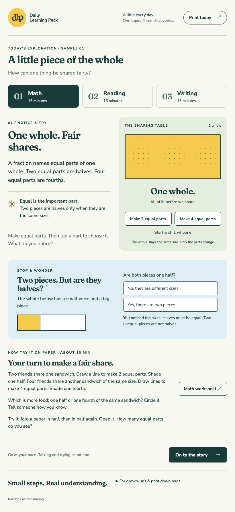

# Daily Learning Pack (public view)

**Display-only** Wonder Daily archive and library for shared family learning. This repository hosts committed static files. Families open a morning on GitHub Pages; they do not run generators here.

Live:

- Archive landing: [https://kbo4sho.github.io/daily-learning-pack/](https://kbo4sho.github.io/daily-learning-pack/)
- Today (the child’s one tap): [https://kbo4sho.github.io/daily-learning-pack/today/](https://kbo4sho.github.io/daily-learning-pack/today/)

Wonder Daily stays a parent-led family surface. It is **not** on public Wonder Together marketing navigation.



## Generators live in a private repo

Authoring, overnight, archive build, Playwright PDF generation, and pack source of truth are in the private repo **[kbo4sho/daily-learning-generators](https://github.com/kbo4sho/daily-learning-generators)** (free-tier private; not public).

`npm run build`, `generate`, `site`, `overnight`, and `author` in this tree exit with a pointer to that repo.

**Archive chrome is public.** Landing markup and CSS live here (`src/archive-render.mjs`, `src/archive.css`). `npm run archive` reapplies that chrome onto `dist/archive.json` without generators. Each heirloom seed packet is one native link: the child’s door opens `today/`, and shelf packets open their own day. The tiny `src/archive.js` adds Space-key activation; clicking and Enter also work without JavaScript.

## How the public site is updated

1. Private generators run `npm run site` (archive at `dist/index.html`, latest approved pack at `dist/today/`).
2. Private Actions **Sync built view to public pack** (or the manual steps in that repo’s `scripts/sync-to-public.md`) opens a **draft** PR here that updates committed `dist/`.
3. A human merges. **No auto-merge.**
4. GitHub Pages on `main` runs `npm run archive` (public chrome only) and deploys `dist/`. It does **not** run `npm run site`.

Captain must store a fine-grained PAT named `PUBLIC_VIEW_PUSH_TOKEN` on the **private** repo (Contents + Pull requests on this public repo only). This view repo does not hold that secret. First-time private checkout: [`docs/private-generators.md`](docs/private-generators.md).

## Preview committed artifacts

Requires **Node.js 22+**. Previewing committed pages needs no browser installation, fonts toolchain, or pack authoring.

```sh
npm ci
npm test
npm run preview
```

Open [http://127.0.0.1:4173/daily-learning-pack/](http://127.0.0.1:4173/daily-learning-pack/). For an iPad on the same Wi-Fi: `HOST=0.0.0.0 npm run preview`.

Browser checks: `npx playwright install chromium webkit`, then `npm run test:browser`. CI runs the same Chromium and WebKit suite.

## GitHub Pages

Workflow: `.github/workflows/pages.yml`. On push to `main` (and manual **workflow_dispatch**), it runs `npm run archive` (copy public landing CSS/HTML onto `dist/archive.json`), checks that `dist/index.html` and `dist/today/index.html` exist, uploads `dist/`, and deploys. No `npm run site`, no Chromium.

Expected URL: [https://kbo4sho.github.io/daily-learning-pack/](https://kbo4sho.github.io/daily-learning-pack/).

If Vercel project **wonder-daily** still points at this repo, it must serve committed `dist/` the same way (`vercel.json` does not install Playwright or generate).

## What you are looking at

The seeded view is the approved **curiosity bean** morning (_A bean becomes._) plus the archive landing. Reading, math, and writing stay on the pack pages under `/today/` and `/days/curiosity-bean/`. Print PDFs are in each day’s `pdf/` folder when the private build included them.

No accounts, backend, tracking, external font requests, or runtime AI. Digital writing stays in memory and is not submitted.

## Design

Runtime CSS in `dist/` is canonical for the published site. Product notes: [DESIGN.md](DESIGN.md). Split notes: [OUTCOME.md](OUTCOME.md).

## Output privacy guard

`npm test` scans all current output, README, tests, source, scripts, and docs for a case-sensitive whole-word personal-name match, absolute home paths, and local machine hostnames. Inline JSON is decoded too. PDF checks use Poppler (`pdftotext` and `pdfinfo`) for extracted text, Info, and XMP, plus raw PDF dictionaries. Image metadata is checked with ExifTool. Install Poppler and ExifTool before running the tests; the test provisions missing tools on the ephemeral Ubuntu GitHub Actions runner. Missing tools or missing output fail the check.

Compressed image/font bytes are not text. Vendored minified fontkit contains property access that resembles a local hostname; only the hostname check is excluded inside `vendor/`. Name and home-path checks still run there, and vendor files stay byte-identical.

## `/little/` — packs for little explorers

`dist/little/` is a second, separate public view (today, `days/<slug>/`, archive) built by the private
generators (`npm run little:nightly` there). Its only identifier is the opaque id `little`; no learner
configuration, age, grade, birthday or name is ever published, and `scripts/privacy-check.mjs` applies a
stricter ban list inside `/little/`. `tests/little.test.mjs` and `tests/little-browser.mjs` (phone and
desktop widths, axe) cover it.

## Library index

`dist/library/6-8.json` and `dist/library/4-5.json` are generated in the private
repo from pack tags and publication dates. Each contains `schemaVersion: 1`
and `entries` with exactly `id`, `band`, `topic`, `why`, `skills`, `date`, `format`,
`status`, and `hidden`. Ids are day slugs, unique within a band. Each published
day has at least three distinct skills and a format (`curiosity-day` or
`picture-pack`). `hidden` controls listing visibility; it is not access control.
The manifests contain no learner identity or settings. `why` is a required
parent-facing sentence: one nonempty trimmed line, at most 180 characters.
It must match the published `pack.json` or second-learner `day.json` (and its
archive record). The family surface uses this metadata. Day sections follow story → why →
activities; the second learner’s pages show the same required why sentence.

`npm run archive` validates the manifests against all published days and their
tags and derives the archive's band labels. `/little/` retains its opaque tags
and age-free child pages. `dist/library/` contains only JSON manifests and
remains outside Wonder Together marketing navigation.

## Bookmark-only family surface

The private generators also publish `dist/family/`: two character doors, each
opening the current default pack, past days, and a stable print shelf. The
family manifest has a strict schema in `src/family-contract.mjs`; it contains
only public pack metadata and same-origin links. The public archive renderer
preserves these files without adding navigation to them.

All family pages are static, `noindex,nofollow`, and work without JavaScript.
An optional nickname editor stores text only in that browser’s localStorage;
no nickname enters artifacts, cookies, URLs or network requests. The print
shelf lists existing current PDFs and a static next-morning readiness state.
The stricter family privacy guard rejects learner identities and audience
labels. No account, selection service or marketing navigation is added.
